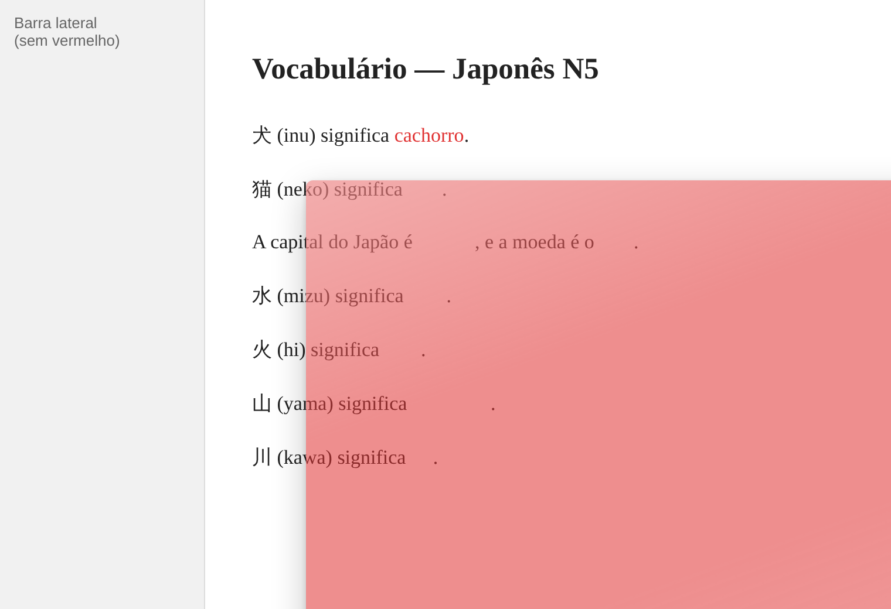
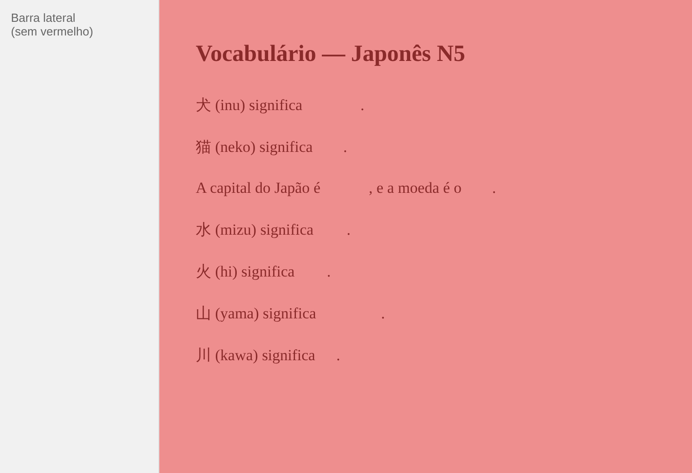

# Red Sheet

Study with the Japanese **red sheet** technique (赤シート) in Obsidian: write the answers in red, cover them with a red sheet, try to remember, then move the sheet away to check.



## Marking what to memorize

- **Double braces:** `The capital of Japan is {{Tokyo}}.` shows "Tokyo" in red pen. The braces are hidden in Live Preview and Reading view.
- **Text colored red or orange** with inline HTML, for example `<span style="color:red">water</span>` or `<font color="#ff6a00">fire</font>`. Can be turned off in settings.
- **Highlights** (optional): turn on "Also hide ==highlights==" in settings to treat `==highlighted text==` as marked.

Marks inside code blocks, inline code and math are ignored.

## Studying

### Red sheet

Click the layers icon in the ribbon, or run the command **Toggle red sheet**. A sheet of red plastic lies over the note area, like on a desk:

- Grab it anywhere and drag. It can slide past the edges of the note.
- Resize it from the bottom-right corner.
- Red text disappears wherever the sheet covers it, and reappears line by line as you slide the sheet away.
- Hover a covered mark to peek at it (can be turned off).
- The note still scrolls underneath the sheet.
- If the sheet gets lost, run **Move red sheet back onto the note**.

### Red filter

Click **Filter** in the status bar, or run **Toggle red filter over the note**. The whole note area turns red and every mark disappears. Turn it off to check your answers.



## Settings

- Detect red-colored text
- Also hide highlights
- Pen color
- Peek on hover
- Sheet color and strength

The interface follows Obsidian's language: Portuguese when Obsidian is set to Portuguese, English otherwise.

## Installation

From Obsidian: **Settings → Community plugins → Browse**, search for "Red Sheet".

Manually: download `main.js`, `manifest.json` and `styles.css` from the [latest release](../../releases/latest) into `<vault>/.obsidian/plugins/red-sheet/`, then enable the plugin.

## Development

```bash
npm install
npm run build   # type-checks and bundles src/ into main.js
npm run lint
```

## License

[MIT](LICENSE)
